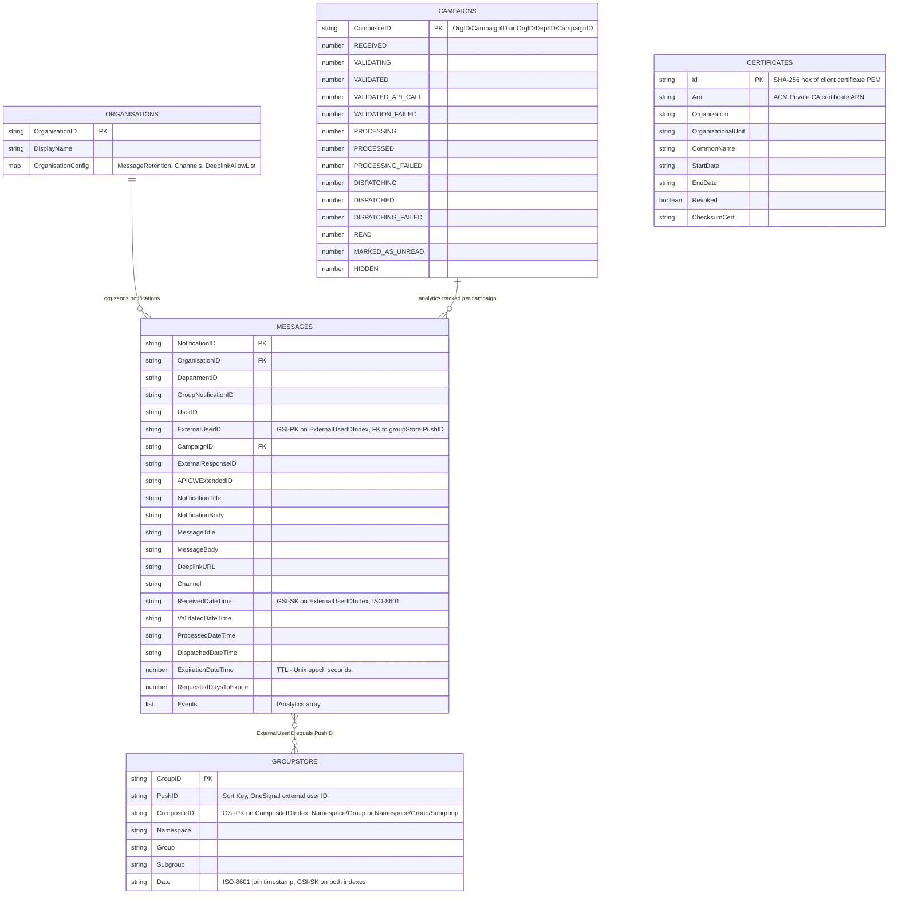

# DynamoDB Data Model

This document describes every DynamoDB table in the Unified Notification Service: their keys, indexes, item shapes, sample values, and the logical relationships between them.

> **Note on relationships:** DynamoDB does not enforce foreign keys. Relationships below are logical, application-level conventions enforced in service code.

All tables use on-demand (PAY_PER_REQUEST) billing and are encrypted with the shared KMS key. PITR is enabled with 30-day recovery. Table names are prefixed with the deployment environment (e.g. `dev-messages`), resolved at Lambda cold-start via SSM parameters.

---

## Entity-Relationship Diagram



---

## Table Reference

### `messages`

Central notification store. One item per notification, written at intake and updated as it progresses through the pipeline.

#### Keys & Indexes

| | Name | Hash key | Range key | Projection |
|---|---|---|---|---|
| Table | - | `NotificationID` (S) | - | - |
| GSI | `DepartmentIDIndex` | `NotificationID` (S) | `DepartmentID` (S) | KEYS_ONLY |
| GSI | `ExternalUserIDIndex` | `ExternalUserID` (S) | `ReceivedDateTime` (S) | ALL |

TTL attribute: `ExpirationDateTime` - default duration 30 days, overridable via `RequestedDaysToExpire`.

#### Attributes

| Attribute | DynamoDB type | Required | Sample value | Notes |
|-----------|--------------|----------|--------------|-------|
| `NotificationID` | `S` | ✓ | `"a1b2c3d4-5e6f-..."` | **PK.** UUID generated at intake. |
| `OrganisationID` | `S` | ✓ | `"DVSA"` | Extracted from mTLS certificate. FK -> `organisations.OrganisationID`. |
| `DepartmentID` | `S` | - | `"TEST01"` | Optional sub-org scope. GSI range key on `DepartmentIDIndex`. |
| `GroupNotificationID` | `S` | - | `"grp-uuid"` | Set when dispatched as part of a group send. |
| `UserID` | `S` | - | `"user-abc"` | Caller-supplied opaque user identifier. |
| `ExternalUserID` | `S` | - | `"ext-user-abc123"` | OneSignal external user ID resolved from `UserID` via UDP. GSI hash key on `ExternalUserIDIndex`. FK -> `groupStore.PushID`. |
| `CampaignID` | `S` | - | `"CAM_ID"` | Caller-supplied campaign tag. Analytics handler assembles `campaigns.CompositeID` from this + org/dept. |
| `ExternalResponseID` | `S` | - | `"onesignal-response-id"` | Response ID from the push provider. |
| `APIGWExtendedID` | `S` | - | `"c6af9ac6-7b61-..."` | API Gateway request ID for tracing. |
| `NotificationTitle` | `S` | ✓ | `"You have a new Notification"` | Title as sent by the PSO. |
| `NotificationBody` | `S` | ✓ | `"Here is the body."` | Body as sent by the PSO. |
| `MessageTitle` | `S` | - | `"You have a new Message"` | Overridden title produced post-processing. |
| `MessageBody` | `S` | - | `"Open Notification Centre..."` | Overridden body produced post-processing. |
| `DeeplinkURL` | `S` | - | `"https://app.example.gov.uk/..."` | Deep-link URL validated against `OrganisationConfig.DeeplinkAllowList`. |
| `Channel` | `S` | - | `"ONESIGNAL"` | `ChannelsEnum` value. |
| `ReceivedDateTime` | `S` | - | `"2026-01-01T12:00:00.000Z"` | ISO-8601; set when validation completes. GSI range key on `ExternalUserIDIndex`. |
| `ValidatedDateTime` | `S` | - | `"2026-01-01T12:00:01.000Z"` | ISO-8601. |
| `ProcessedDateTime` | `S` | - | `"2026-01-01T12:00:02.000Z"` | ISO-8601. |
| `DispatchedDateTime` | `S` | - | `"2026-01-01T12:00:03.000Z"` | ISO-8601. |
| `ExpirationDateTime` | `N` | - | `1767254400` | **TTL.** Unix epoch seconds. A string fallback transform handles pre-migration data. |
| `RequestedDaysToExpire` | `N` | - | `14` | Positive integer; overrides the default 30-day TTL if the org allows custom retention. |
| `Events` | `L` | ✓ | `[]` | Array of `IAnalytics` objects appended by the analytics handler (see below). |

#### `Events` item shape (`IAnalytics`)

| Attribute | DynamoDB type | Required | Sample value | Notes |
|-----------|--------------|----------|--------------|-------|
| `EventID` | `S` | ✓ | `"evt-uuid"` | UUID per event. |
| `NotificationID` | `S` | ✓ | `"a1b2c3d4-..."` | Parent notification. |
| `OrganisationID` | `S` | ✓ | `"DVSA"` | |
| `CampaignID` | `S` | - | `"CAM_ID"` | |
| `DepartmentID` | `S` | - | `"TEST01"` | |
| `APIGWExtendedID` | `S` | - | `"c6af9ac6-..."` | |
| `EventDateTime` | `S` | ✓ | `"2026-01-01T12:00:01.000Z"` | ISO-8601. |
| `Event` | `S` | - | `"DISPATCHED"` | `NotificationStateEnum` value; defaults to `UNKNOWN`. |
| `EventReason` | `S` | - | `"Push provider accepted"` | Free-text reason. |

#### Sample item

```json
{
  "NotificationID": "a1b2c3d4-5e6f-7890-abcd-ef1234567890",
  "OrganisationID": "UNS",
  "DepartmentID": "TEST01",
  "UserID": "UserID",
  "ExternalUserID": "2536bd9b-611b-453c-ba3d-e34783e4c9d1",
  "CampaignID": "CAM_ID",
  "NotificationTitle": "You have a new Notification",
  "NotificationBody": "Here is the Notification body.",
  "MessageTitle": "You have a new Message",
  "MessageBody": "Open Notification Centre to read your notifications",
  "APIGWExtendedID": "c6af9ac6-7b61-11e6-9a41-93e8deadbeef",
  "ReceivedDateTime": "2026-01-01T12:00:00.000Z",
  "ValidatedDateTime": "2026-01-01T12:00:01.000Z",
  "ProcessedDateTime": "2026-01-01T12:00:02.000Z",
  "DispatchedDateTime": "2026-01-01T12:00:03.000Z",
  "ExpirationDateTime": 1767254400,
  "Events": [
    {
      "EventID": "evt-uuid",
      "NotificationID": "a1b2c3d4-5e6f-7890-abcd-ef1234567890",
      "OrganisationID": "UNS",
      "EventDateTime": "2026-01-01T12:00:03.000Z",
      "Event": "DISPATCHED"
    }
  ]
}
```

---

### `campaigns`

Analytics counter store. One item per campaign (or per org/dept/campaign combination). All counters are atomically incremented using `if_not_exists(counter, 0) + 1`, so no item needs to be initialised before the first event arrives.

#### Keys & Indexes

| | Name | Hash key |
|---|---|---|
| Table | - | `CompositeID` (S) |

No sort key, no GSIs, no TTL.

#### Attributes

| Attribute | DynamoDB type | Required | Sample value | Notes |
|-----------|--------------|----------|--------------|-------|
| `CompositeID` | `S` | ✓ | `"ORG01/CAM_ID"` | **PK.** Format: `{OrganisationID}/{CampaignID}` or `{OrganisationID}/{DepartmentID}/{CampaignID}`. Assembled by the analytics handler from the notification's fields. |
| `RECEIVED` | `N` | - | `5` | Atomic counter for each `NotificationStateEnum` value. |
| `VALIDATING` | `N` | - | `5` | |
| `VALIDATED` | `N` | - | `4` | |
| `VALIDATED_API_CALL` | `N` | - | `1` | |
| `VALIDATION_FAILED` | `N` | - | `1` | |
| `PROCESSING` | `N` | - | `4` | |
| `PROCESSED` | `N` | - | `4` | |
| `PROCESSING_FAILED` | `N` | - | `0` | |
| `DISPATCHING` | `N` | - | `4` | |
| `DISPATCHED` | `N` | - | `3` | |
| `DISPATCHING_FAILED` | `N` | - | `1` | |
| `READ` | `N` | - | `2` | |
| `MARKED_AS_UNREAD` | `N` | - | `1` | |
| `HIDDEN` | `N` | - | `1` | |

#### Sample item

```json
{
  "CompositeID": "ORG01/CAM_ID",
  "VALIDATING": 2,
  "VALIDATED": 1,
  "VALIDATED_API_CALL": 1,
  "PROCESSING": 1,
  "PROCESSED": 1,
  "DISPATCHING": 1,
  "DISPATCHED": 1,
  "READ": 1,
  "HIDDEN": 1
}
```

---

### `groupStore`

Group membership store. One item per (group, user) pair. Only created when the `featureFlag.groups` CDK config flag is enabled.

#### Keys & Indexes

| | Name | Hash key | Range key | Projection |
|---|---|---|---|---|
| Table | - | `GroupID` (S) | `PushID` (S) | - |
| GSI | `PushIDIndex` | `PushID` (S) | `Date` (S) | ALL |
| GSI | `CompositeIDIndex` | `CompositeID` (S) | `Date` (S) | ALL |

`CompositeIDIndex` is the primary fan-out index: `postGroupMessage` queries all members of a group by `CompositeID` to build the per-user dispatch batch.

`PushIDIndex` allows the Flex API to list all groups a given user belongs to.

#### Attributes

| Attribute | DynamoDB type | Required | Sample value | Notes |
|-----------|--------------|----------|--------------|-------|
| `GroupID` | `S` | ✓ | `"GROUP-01"` | **PK.** UUID assigned when a user joins a group. |
| `PushID` | `S` | ✓ | `"2536bd9b-611b-453c-ba3d-e34783e4c9d1"` | **SK.** User's OneSignal external user ID. Equals `messages.ExternalUserID`. GSI hash key on `PushIDIndex`. |
| `CompositeID` | `S` | ✓ | `"travel/spain/IMMEDIATE"` | Format: `{Namespace}/{Group}` or `{Namespace}/{Group}/{Subgroup}`. GSI hash key on `CompositeIDIndex`. |
| `Namespace` | `S` | ✓ | `"travel"` | Group namespace. |
| `Group` | `S` | ✓ | `"spain"` | Group name within the namespace. |
| `Subgroup` | `S` | - | `"IMMEDIATE"` | Optional subdivision of a group (e.g. delivery priority). |
| `Date` | `S` | ✓ | `"2026-01-01T12:00:00.000Z"` | ISO-8601 timestamp of when the user joined. GSI range key on both `PushIDIndex` and `CompositeIDIndex`. |

#### Sample item

```json
{
  "GroupID": "GROUP-01",
  "PushID": "2536bd9b-611b-453c-ba3d-e34783e4c9d1",
  "CompositeID": "travel/spain/IMMEDIATE",
  "Namespace": "travel",
  "Group": "spain",
  "Subgroup": "IMMEDIATE",
  "Date": "2026-01-01T12:00:00.000Z"
}
```

---

### `organisations`

Configuration store for PSO organisations. Seeded at deploy time from `infrastructure/cdk/consumers/consumersMetadata.ts` via a custom CDK resource. One item per organisation.

#### Keys & Indexes

| | Name | Hash key |
|---|---|---|
| Table | - | `OrganisationID` (S) |

No sort key, no GSIs, no TTL.

#### Attributes

| Attribute | DynamoDB type | Required | Sample value | Notes |
|-----------|--------------|----------|--------------|-------|
| `OrganisationID` | `S` | ✓ | `"DVSA"` | **PK.** Short org code. Matched against the value extracted from the mTLS certificate at request time. |
| `DisplayName` | `S` | ✓ | `"Driver and Vehicle Standards Agency"` | Human-readable organisation name. |
| `OrganisationConfig` | `M` | ✓ | see below | Nested configuration object. |

#### `OrganisationConfig` shape

| Field | DynamoDB type | Required | Sample value | Notes |
|-------|--------------|----------|--------------|-------|
| `MessageRetention.Allowed` | `BOOL` | ✓ | `false` | Whether the org may request a custom message TTL via `RequestedDaysToExpire`. |
| `MessageRetention.Min` | `N` | when Allowed=true | `7` | Minimum allowed retention in days. |
| `MessageRetention.Max` | `N` | when Allowed=true | `90` | Maximum allowed retention in days. |
| `Channels` | `L` of `S` | ✓ | `["PUSH_NOTIFICATION_AND_MESSAGE_CENTRE"]` | Allowed `ChannelsEnum` values: `PUSH_NOTIFICATION_AND_MESSAGE_CENTRE` or `MESSAGE_CENTRE_ONLY`. |
| `DeeplinkAllowList` | `L` of `M` | ✓ | `[{"protocol":"https","hostname":"example.gov.uk"}]` | Allowed deep-link origins. Each entry must have at least one of `protocol` or `hostname`. |

#### Sample item

```json
{
  "OrganisationID": "ORG01",
  "DisplayName": "ORG",
  "OrganisationConfig": {
    "MessageRetention": { "Allowed": false },
    "Channels": ["PUSH_NOTIFICATION_AND_MESSAGE_CENTRE"],
    "DeeplinkAllowList": [
      { "protocol": "https", "hostname": "example.gov.uk" }
    ]
  }
}
```

---

### `certificates`

mTLS client certificate revocation table. One item per issued certificate. **Only created in main environments** (`dev`, `stg`, `prod`); sandbox stacks consume it via a cross-account SSM reference to the table ARN. Seeded at deploy time when client certificates are issued.

#### Keys & Indexes

| | Name | Hash key |
|---|---|---|
| Table | - | `Id` (S) |

No sort key, no GSIs, no TTL.

#### Attributes

| Attribute | DynamoDB type | Required | Sample value | Notes |
|-----------|--------------|----------|--------------|-------|
| `Id` | `S` | ✓ | `"a3f5b9c1..."` | **PK.** SHA-256 hex digest of the client certificate PEM. Matched against the hash CloudFront forwards in the mTLS authorizer. |
| `Arn` | `S` | ✓ | `"arn:aws:acm-pca:eu-west-2:..."` | ACM Private CA certificate ARN. |
| `Organization` | `S` | ✓ | `"DVSA"` | Organisation this certificate was issued to. |
| `OrganizationalUnit` | `S` | ✓ | `"Digital"` | |
| `CommonName` | `S` | ✓ | `"dvsa.client.dev"` | Certificate common name. |
| `StartDate` | `S` | ✓ | `"2026-01-01T00:00:00.000Z"` | Certificate validity start (ISO-8601). |
| `EndDate` | `S` | ✓ | `"2027-01-01T00:00:00.000Z"` | Certificate validity end (ISO-8601). |
| `Revoked` | `BOOL` | ✓ | `false` | `true` if the certificate has been revoked. The authorizer rejects requests carrying a revoked certificate. |
| `ChecksumCert` | `S` | ✓ | `"sha256-hex..."` | Additional certificate integrity checksum. |

---

## Lambda Access Matrix

| Lambda | messages | campaigns | groupStore | organisations | certificates |
|--------|:--------:|:---------:|:----------:|:-------------:|:------------:|
| `pso/http.postMessage` | rw | - | - | - | - |
| `pso/http.getNotificationStatus` | r | - | - | - | - |
| `pso/http.getCampaignStatus` | - | r | - | - | - |
| `pso/http.postGroupMessage` | - | - | r | - | - |
| `pso/http.mtlsCertificateRevocationAuthorizer` | - | - | - | r | r |
| `pso/sqs.validation` | rw | rw | - | - | - |
| `pso/sqs.processing` | rw | - | - | - | - |
| `pso/sqs.dispatch` | rw | - | - | - | - |
| `pso/sqs.analytics` | rw | rw | - | - | - |
| `pso/sqs.groupProcessingWorker` | rw | - | - | - | - |
| `flex/http.getNotifications` | r | - | - | r | - |
| `flex/http.getNotificationById` | r | - | - | r | - |
| `flex/http.deleteNotification` | r | - | - | - | - |
| `flex/http.patchNotification` | r | - | - | - | - |
| `flex/http.getGroups` | - | - | rw | - | - |
| `flex/http.modifyGroups` | - | - | rw | - | - |

`r` = read only, `rw` = read + write

---

## Common Table Properties

| Property | Value |
|----------|-------|
| Billing mode | `PAY_PER_REQUEST` |
| Encryption | Shared KMS key (per-stack) |
| PITR | Enabled, 30-day recovery |
| Deletion protection | Enabled on `dev` / `stg` / `prod` |
| Table name prefix | `{env}-` (e.g. `dev-messages`) |
| Name resolution | Via SSM parameter at Lambda cold-start (`IDynamoAttributes`) |
| SSM parameter paths | `table/message/attributes`, `table/campaigns/attributes`, `table/groupstore/attributes`, `table/organisations/attributes`, `table/mtls/attributes` |
