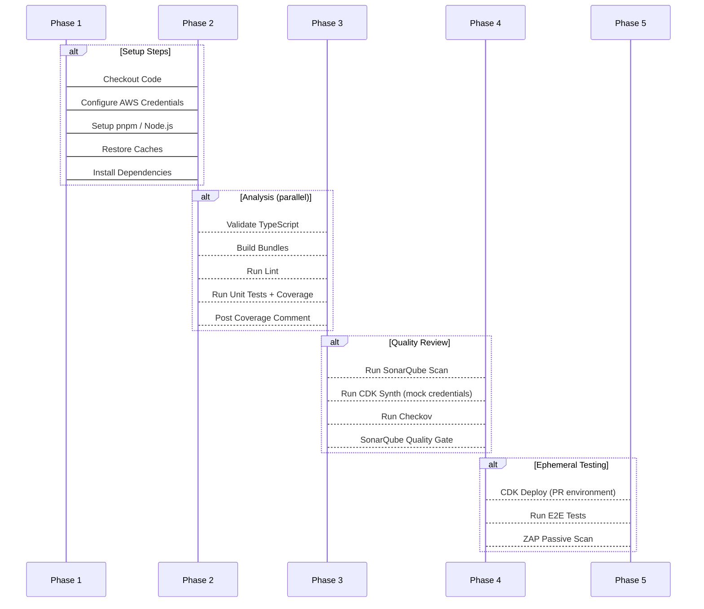
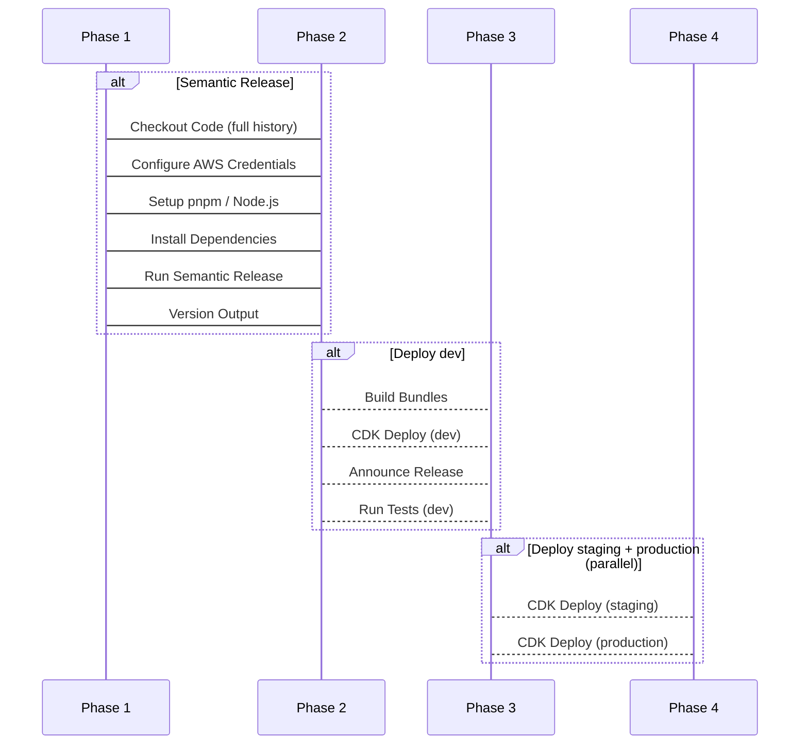
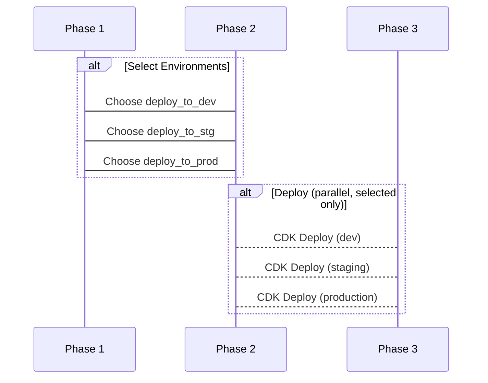

# Deployment Guide

CI/CD pipelines, environments and deployment workflows for the GDS Unified Notification Service. This is the single reference for every GitHub Actions workflow in [`.github/workflows`](/.github/workflows).

---

## Overview

One CDK app ([`infrastructure/cdk/cdk.ts`](/infrastructure/cdk/cdk.ts)) defines up to four stacks per environment, and `pnpm run cdk:deploy` deploys all of them (`cdk deploy --all`):

| Stack | Name | Region | Contents |
| --- | --- | --- | --- |
| `UNSGlobalStack` | `uns-<env>-global-stack` | `us-east-1` | CloudFront-scoped WAF (AWS requires it in us-east-1) |
| `UNSStack` | `uns-<env>-stack` | `eu-west-2` | Everything else: PSO and Flex services, data stores, mTLS. Depends on the global stack through cross-region references |
| `UNSAlarmsStack` | `uns-<env>-alarms-stack` | `eu-west-2` | CloudWatch alarms, see [Alarms](./alarms.md). Depends on `UNSStack` |
| `UNSTestingStack` | `uns-<env>-e2e-testing-stack` | `eu-west-2` | CodeBuild e2e runner inside the VPC. Only for `dev`, `stg` and ephemeral PR environments (`config.deployE2ERunner`) |

See the [Infrastructure Development Guide](./infrastructure-development.md) for what each stack contains.

### Environments

| Environment | `env` value (CDK) | GitHub Environment | Persistence | Deployed by |
| --- | --- | --- | --- | --- |
| Personal sandbox | `<you>-<hash>` | | Ephemeral | You, via `pnpm run development:sandbox:release` |
| PR environment | `<PR number>` (from `pr_number`) | `ephemeral` | Ephemeral, destroyed when the PR closes | CI ([`_ephemeral.testing.yml`](#ephemeral-pr-environments)) |
| Development | `dev` | `dev` | Persistent | CI/CD (`main.release.yml`, or manually) |
| Staging | `stg` | `staging` | Persistent | CI/CD (`main.release.yml`, or manually) |
| Production | `prod` | `production` | Persistent | CI/CD (`main.release.yml`, or manually) |

The CDK `env` value and the GitHub Environment name differ (`stg`/`prod` vs `staging`/`production`). [`_deploy.yml`](/.github/workflows/_deploy.yml) bridges them with the GitHub Environment variable `ENVIRONMENT_SHORTHAND`, passed to CDK as the `env` process variable. For PR environments, setting `pr_number` makes [`config.ts`](/infrastructure/cdk/config.ts) use the PR number as `env` (so resources are named `uns-<PR>-...`) and sets `isEphemeral`. Only `dev`, `stg` and `prod` are persistent (`unremovableEnvironments`). Everything else, sandboxes and PR environments alike, gets `RemovalPolicy.DESTROY` and imports shared infrastructure (VPC, mTLS CA, revocation table) from `dev` via SSM; see [Infrastructure Development Guide: Sandbox environments](./infrastructure-development.md#sandbox-environments).

---

## Personal sandbox

Deploy your own stacks for local development and testing.

### Prerequisites

Complete the [Environment Setup](./environment-setup.md) steps first, including `pnpm run development:sandbox:setup`.

### Deploy

```sh
pnpm run development:sandbox:release   # build + cdk deploy (all stacks)
pnpm run development:sandbox:plan      # build + cdk diff --all (preview only, no changes applied)
```

These map to `pnpm run build && pnpm run cdk:deploy` and `pnpm run build && pnpm run cdk:diff`; see [`package.json`](/package.json). `cdk:deploy` runs three steps in sequence:

```sh
pnpm run cdk:predeploy:ssm   # ensure operator-configurable SSM parameters exist (infrastructure/cdk/cdk.predeploy.ssm.ts)
pnpm run cdk deploy --all --require-approval never --import-existing-resources true
pnpm run cdk:postdeploy:ssm  # write the Flex private API key/URL into Secrets Manager (infrastructure/cdk/cdk.postdeploy.ssm.ts)
```

The pre and post SSM steps exist so that CDK never owns values that need to change independently of a deploy (feature flags, adapter selection), or values that can't safely be expressed as CloudFormation tokens (a freshly generated API key). See [Configuration](./configuration.md#how-runtime-parameters-are-managed).

### Verify

```sh
pnpm run test:unit                   # unit tests, run once
env=<your-env> pnpm run test:e2e     # e2e against your sandbox
```

`pnpm test` runs Vitest in **watch mode** (both projects); use it while developing, not as a one-off check. E2E needs mTLS client certificates; `pnpm run download:certificates` fetches them from Secrets Manager. See [`test/e2e/README.md`](/test/e2e/README.md#prerequisites).

### Destroy

There is no dedicated `destroy` script; use the CDK CLI directly:

```sh
pnpm run cdk destroy --all
```

---

## Persistent environments

Persistent environments (`dev`, `staging`, `production`) deploy via CI/CD only. See [Environment Setup: AWS credentials](./environment-setup.md#aws-credentials) if you need read access to inspect them. There is no supported path for deploying to them from a local machine outside a break-glass incident.

GitHub Environment protection rules (required reviewers) and the branch protection rules that make checks merge-blocking are configured in repository settings, not in workflow files.

---

## CI/CD workflows

| Workflow | Trigger | Purpose |
| --- | --- | --- |
| [`pr.yml`](/.github/workflows/pr.yml) | Pull request | Build, lint, test, then quality review, ephemeral deploy + e2e, and ZAP passive scan |
| [`pr.title-validation.yml`](/.github/workflows/pr.title-validation.yml) | Pull request | PR title matches the commit convention |
| [`pr.cleanup.yml`](/.github/workflows/pr.cleanup.yml) | Pull request closed | Destroy the PR environment |
| [`main.release.yml`](/.github/workflows/main.release.yml) | Push to `main` | semantic-release, then deploy `dev` → `staging` + `production` |
| [`manual.deploy.yml`](/.github/workflows/manual.deploy.yml) | `workflow_dispatch` | Redeploy without a release |
| [`main.sonar.yml`](/.github/workflows/main.sonar.yml) | Push to `main` | SonarQube scan of `main` |
| [`main.pages.yml`](/.github/workflows/main.pages.yml) | Push to `main` | Publish `docs/` to GitHub Pages |
| [`zaproxy.yml`](/.github/workflows/zaproxy.yml) | Daily at 01:00 UTC | ZAP **active** scan against `dev` |

Reusable workflows (`workflow_call` only): [`_quality.review.yml`](/.github/workflows/_quality.review.yml), [`_ephemeral.testing.yml`](/.github/workflows/_ephemeral.testing.yml), [`_zaproxy.yml`](/.github/workflows/_zaproxy.yml), [`_deploy.yml`](/.github/workflows/_deploy.yml), [`_test_e2e.yml`](/.github/workflows/_test_e2e.yml).

All jobs that need dependencies log into the private CodeArtifact registry, using OIDC to assume `AWS_CODEARTIFACT_ROLE_ARN` (non-deploying jobs) or the environment's `AWS_DEPLOY_ROLE_ARN`.

### PR pipeline (`pr.yml`)

**Trigger:** any pull request event. Runs are grouped per PR with `cancel-in-progress: true`, so pushing again cancels the previous run.



1. **`pr`**: restores the TypeScript build-info and ESLint caches, installs, then runs in parallel `build:validate`, `build`, `lint` and `test:coverage`. The coverage summary is posted as a PR comment. It uploads two artifacts, `dist` (the Lambda bundles) and `coverage.report`, so later jobs don't rebuild.

   > The test step captures pnpm's exit code via `PIPESTATUS[0]` and calls `exit` at the end, so **failing unit tests or a missed coverage threshold fail this job**. The coverage summary is always exported to the PR comment before the step exits (including a readable message if vitest crashes before coverage runs). Typecheck, build and lint failures also fail the job.

2. **`codeQualityReview`** ([`_quality.review.yml`](/.github/workflows/_quality.review.yml)) downloads `dist` and `coverage.report`, then:
   - starts the SonarQube scan in the background
   - runs `cdk:synth` against a mock `cicd` environment, with AWS credentials blanked so nothing is assumed or deployed
   - runs Checkov over `packages/infrastructure/cdk/cdk.out/` (`soft_fail: true`) and uploads SARIF to GitHub code scanning
   - waits for Sonar, then runs the **SonarQube Quality Gate** check, which fails the job if the gate fails, and posts the gate status as a PR comment

3. **`ephemeralTesting`**: deploys a PR environment and runs e2e against it; see [Ephemeral PR environments](#ephemeral-pr-environments).

4. **`zaproxyScan`**: a passive ZAP scan against the PR environment; see [ZAP security scanning](#zap-security-scanning).

<details>
  <summary>Step summaries — <code>pr</code> job</summary>

- **Checkout Code**: checks out the repository with `persist-credentials: false`.
- **Configure AWS credentials**: assumes `AWS_CODEARTIFACT_ROLE_ARN` via OIDC to reach the private npm registry. No deploy role is assumed here.
- **Configure CodeArtifact**: runs `aws codeartifact login` to set up the npm registry token for `pnpm`.
- **Setup pnpm / Node.js**: pins versions from `.node-version` and the pnpm `packageManager` field; restores the pnpm store cache.
- **Restore caches**: restores the TypeScript incremental build cache (`tsconfig.tsbuildinfo`) and the ESLint result cache (`.eslintcache`) in parallel to speed up analysis.
- **Install Dependencies**: `pnpm ci` — clean install from the lockfile.
- **Validate TypeScript** (`build:validate`): runs `tsc --noEmit` to type-check without emitting files. Fails the job on any type error.
- **Build bundles** (`build`): esbuild bundles all Lambdas into `dist/`. The `dist` artifact is uploaded for downstream jobs so they don't rebuild.
- **Run Lint**: ESLint + Prettier check; fails the job on any error.
- **Run Unit tests & report coverage**: runs `pnpm test:coverage`; the coverage summary is written to `coverage.md` and exported as a step output. The step uses `PIPESTATUS[0]` to capture pnpm's exit code and calls `exit` after the export, so **a failing test or missed threshold fails the job**. The PR comment is always posted (with a fallback message if vitest crashes before coverage runs).
- **Upload artifacts**: uploads `coverage.report` and `dist` in parallel for downstream jobs.
- **Create Comment with Test results**: posts the coverage summary to the PR as a comment (recreated on each push).

</details>

### Ephemeral PR environments

[`_ephemeral.testing.yml`](/.github/workflows/_ephemeral.testing.yml) runs in the `ephemeral` GitHub Environment, one run at a time per PR (`cancel-in-progress: false`, so a deploy is never interrupted halfway):

1. Downloads the `dist` artifact (falling back to `pnpm run build`).
2. Runs `cdk:predeploy:ssm`, then `cdk deploy --all` with `pr_number=<PR>`, creating `uns-<PR>-global-stack`, `uns-<PR>-stack`, `uns-<PR>-alarms-stack` and `uns-<PR>-e2e-testing-stack`.
3. Runs `pnpm test:e2e` from the GitHub runner with `env=<PR>`.

When the PR is closed or merged, [`pr.cleanup.yml`](/.github/workflows/pr.cleanup.yml) runs `cdk destroy uns-<PR>-stack --force` (CDK also destroys the stacks that depend on it: alarms and e2e testing), then `cdk:ephemeral:cleanup:ssm` ([`cdk.ephemeral.cleanup.ssm.ts`](/infrastructure/cdk/cdk.ephemeral.cleanup.ssm.ts)) to delete every SSM parameter under `/uns-<PR>/`. The predeploy script creates those parameters outside CloudFormation, so the stack destroy doesn't remove them.

> `uns-<PR>-global-stack` is a **dependency** of the main stack, not a dependent, so `cdk destroy uns-<PR>-stack` doesn't remove it. Check the us-east-1 CloudFormation console for leftover `uns-<number>-global-stack` stacks.

If cleanup fails (e.g. a resource stuck deleting), re-run the workflow from the Actions tab, or destroy the stacks from a shell with `pr_number=<PR> pnpm run cdk destroy --all`, then `pr_number=<PR> pnpm run cdk:ephemeral:cleanup:ssm`.

### ZAP security scanning

[OWASP ZAP](https://www.zaproxy.org/) scans the PSO and Flex APIs using their OpenAPI specs (`docs/pso/openapi.yml`, `docs/flex/openapi.yml`), so **keep the specs accurate**: an endpoint missing from a spec isn't scanned.

| | PR scan | Nightly scan |
| --- | --- | --- |
| Workflow | `pr.yml` → `_zaproxy.yml` | [`zaproxy.yml`](/.github/workflows/zaproxy.yml) → `_zaproxy.yml` |
| Mode | `passive` ([`zap-passive.yaml`](/infrastructure/cdk/buildspecs/zap-passive.yaml)) | `active` ([`zap-active.yaml`](/infrastructure/cdk/buildspecs/zap-active.yaml)) |
| Target | The PR environment | `dev` |
| Reports | PR comment + job summary | Job summary |

How a run works:

1. [`scripts/configureZaproxyEnv.ts`](/scripts/configureZaproxyEnv.ts) resolves each API's target URL and API key, plus the client certificate (`client.p12`) and its password, for the target environment.
2. The specs, buildspecs and certificate are zipped and uploaded to the environment's `uns-<env>-e2e-runner-builds` bucket, and a CodeBuild **batch** build of `uns-<env>-e2e-runner-project` runs [`zaproxy.buildspec.yml`](/infrastructure/cdk/buildspecs/zaproxy.buildspec.yml). The scan runs from inside the VPC, which is why it uses the e2e runner from `UNSTestingStack`.
3. Markdown reports are copied back from `s3://uns-<env>-e2e-runner-builds/zaproxy/<date>/<ref>/<run>/reports/` and combined into the comment and summary. Full reports and logs stay in S3 under `private-reports/`, linked from the comment.

**Gating:** the ZAP automation plan exits `1` for Medium or higher findings and `2` for Low. The buildspec fails the build on `1`, which fails the workflow, so **a Medium+ finding fails the PR check** (and the nightly run). Low findings only produce a warning annotation.

When a scan fails, open the report from the PR comment or job summary and either fix the finding, or, if it's a false positive, tune the rule in `zap-passive.yaml` / `zap-active.yaml` in the same PR with a comment explaining why.

### Release (`main.release.yml`)

**Trigger:** push to `main`, i.e. every merged PR.

1. **`release`**: runs semantic-release, which tags `v<version>`, generates the changelog and creates the GitHub Release (see the [Releases Guide](./releases.md)), then outputs `semVer`.
2. **`releaseToDev`**: [`_deploy.yml`](#reusable-deploy-workflow) with `ENVIRONMENT: dev`.
3. **`releaseStaging`** and **`releaseProduction`**: both wait for `dev`, then run **in parallel**. Production does not wait for staging.

Every deploy gets `VERSION: <semVer>@<sha>`, which becomes the `code_version` deployed with the Lambdas and appears in the release announcement.



<details>
  <summary>Step summaries — <code>release</code> job</summary>

- **Checkout Code**: full history (`fetch-depth: 0`) so semantic-release can read the entire commit log to compute the next version.
- **Configure AWS credentials**: assumes `AWS_CODEARTIFACT_ROLE_ARN` via OIDC to reach the private npm registry — not a deploy role.
- **Configure CodeArtifact / pnpm / Node.js / Install**: same registry and tooling setup as the `pr` job.
- **Run Semantic Release**: computes the next version from conventional commits, creates the git tag, generates the changelog and publishes the GitHub Release. Outputs `semVer`.
- **Version**: echoes the computed version to the job log.

The `releaseToDev`, `releaseStaging`, and `releaseProduction` jobs all call [`_deploy.yml`](#reusable-deploy-workflow) with the `semVer@sha` version string.

</details>

### Reusable deploy workflow

[`_deploy.yml`](/.github/workflows/_deploy.yml) (`workflow_call` only), used by both the release and manual pipelines:

1. Checkout, assume `secrets.AWS_DEPLOY_ROLE_ARN` via OIDC in the target GitHub Environment, log into CodeArtifact, install, `pnpm run build`.
2. `pnpm run cdk:deploy` with `env=$ENVIRONMENT_SHORTHAND`, `code_version=$VERSION` and `SSM_PARAMETERS_TO_UPDATE` from the GitHub Environment variable (see [Configuration](./configuration.md#how-runtime-parameters-are-managed)).
3. **Announce release** (background, `continue-on-error`): publishes to the release SNS topic; see [Releases: Deployment notifications](./releases.md#deployment-notifications).
4. Post-deploy tests from the GitHub runner, which differ per environment:

| Environment | Runner step | E2E in CodeBuild (`_test_e2e.yml`) |
| --- | --- | --- |
| `dev` | `pnpm test` (unit + e2e) | Yes |
| `staging` | None | Yes |
| `production` | `pnpm test:unit` only | No; e2e would ship test data into production analytics |

The deploy happens *before* testing. The tests are a post-deploy health check, not a release gate; a broken deploy is caught by CloudFormation failing.

<details>
  <summary>Step summaries — <code>_deploy.yml</code></summary>

- **Checkout Code**: `persist-credentials: false`; no full history needed.
- **Show OIDC claims**: prints the OIDC subject claim to the log for debugging. Runs only when Actions debug logging is enabled (`runner.debug`).
- **Configure AWS credentials**: assumes `AWS_DEPLOY_ROLE_ARN` (not the CodeArtifact role) via OIDC, scoped by the GitHub Environment binding.
- **Configure CodeArtifact / pnpm / Node.js / Install**: same registry and tooling setup as the `pr` job.
- **Build bundles**: `pnpm run build` — bundles all Lambdas into `dist/`.
- **CDK Deploy**: `pnpm run cdk:deploy` — runs pre-deploy SSM, `cdk deploy --all`, then post-deploy SSM, passing `env`, `code_version`, `SSM_PARAMETERS_TO_UPDATE` and other env vars.
- **Announce release** (background, `continue-on-error`): publishes a deployment notification to the SNS release topic without blocking post-deploy tests.
- **All Testing suites** (`dev` only): `pnpm test` — full unit + e2e suite against the deployed environment.
- **Limited testing suites** (`production` only): `pnpm test:unit` — unit tests only; e2e writes are deliberately skipped in production to prevent test data appearing in analytics.

</details>

### E2E in CodeBuild (`_test_e2e.yml`)

The Flex API's private API Gateway is only reachable from inside the VPC, so the e2e suite for `dev` and `staging` runs in CodeBuild. The job:

1. Zips the repository and uploads it to `s3://uns-<env>-e2e-runner-builds/e2e/<ref>/`.
2. Starts `uns-<env>-e2e-runner-project` (from `UNSTestingStack`, VPC-attached, running [`e2e-runner.buildspec.yml`](/infrastructure/cdk/buildspecs/e2e-runner.buildspec.yml), i.e. `pnpm run test:e2e`).
3. Polls until the build finishes, then tails the CodeBuild log group into the job output and fails the job if the build didn't succeed.

### Manual Deployment (`manual.deploy.yml`)

**Trigger:** `workflow_dispatch`, with three independent boolean inputs — `deploy_to_dev`, `deploy_to_stg`.

Deploys any combination of environments without cutting a new release. Use it to redeploy the current `main` (e.g. after a failed run, or to pick up an SSM-driven config change), or to roll back with a revert commit already on `main`. Selected environments deploy independently and in parallel, with no `dev`-first ordering, unlike the automatic release pipeline. Each one calls [`_deploy.yml`](#reusable-deploy-workflow) directly with `VERSION: ${{ github.ref_name }}@${{ github.sha }}` rather than a semantic-release version, since no release step runs.



<details>
  <summary>Step summaries</summary>

- **Choose environments**: each of the three boolean inputs (`deploy_to_dev`, `deploy_to_stg`, `deploy_to_prod`) independently gates its environment's job via an `if:` condition — any combination can be selected.
- **Deploy**: each selected environment calls [`_deploy.yml`](#reusable-deploy-workflow) with `VERSION: ${{ github.ref_name }}@${{ github.sha }}`. No semantic-release step runs, so the version label is the branch/tag name and commit SHA rather than a computed semver.

</details>

### Sonar Scan (`main.sonar.yml`)

**Trigger:** push to `main`.

Runs `pnpm run test:coverage`, then a SonarQube scan of `main`. This is separate from the PR-branch scan in `_quality.review.yml` and keeps SonarCloud's view of the default branch current.

### GitHub Pages (`main.pages.yml`)

**Trigger:** push to `main`.

Publishes the committed [`docs/`](/docs) directory (PSO and Flex OpenAPI specs plus their Swagger UI pages) to GitHub Pages. It does **not** generate the specs: `docs/pso/openapi.yml` and `docs/flex/openapi.yml` are maintained by hand. Update them in the same PR as any request or response change, since ZAP scans from them too. See the root [README.md](/README.md#github-pages) for the published URLs.

---

## Troubleshooting

### CDK deploy fails referencing a missing VPC, security group, or mTLS truststore

Sandbox and PR environments import these from `dev` via SSM (`/shared/vpc`, `/shared/mtls/*`) rather than creating their own. Confirm `dev` is healthy and those SSM parameters exist; see [Infrastructure Development Guide: Sandbox environments](./infrastructure-development.md#sandbox-environments).

### `cdk:predeploy:ssm` reports a parameter mismatch or the deploy doesn't pick up a config change

Operator-configurable values live in SSM and are deliberately managed outside CDK by [`cdk.predeploy.ssm.ts`](/infrastructure/cdk/cdk.predeploy.ssm.ts), which only creates missing parameters. Set `SSM_PARAMETERS_TO_UPDATE` (as used by `_deploy.yml`) to overwrite one on deploy, or edit it directly; see [Configuration](./configuration.md).

### E2E tests fail after a deploy with connection or authentication errors

For PSO, check that your mTLS client certificate is current (`pnpm run download:certificates`); see [`test/e2e/README.md`](/test/e2e/README.md#prerequisites) and [Infrastructure Development Guide: mTLS](./infrastructure-development.md#mtls-certificate-infrastructure). For CodeBuild runs, the full log is in the `E2E (Codebuild)` job output, under "View AWS CodeBuild Logs".

### The ZAP scan fails a PR

A Medium or higher finding was raised; see [ZAP security scanning](#zap-security-scanning). The report is in the PR comment and the job summary.

### A PR environment wasn't cleaned up

Re-run `PR Clean Up pipeline` for the PR, or follow the manual steps in [Ephemeral PR environments](#ephemeral-pr-environments).

### A deploy fails partway through CloudFormation

CloudFormation should roll back automatically; check the stack's status in the AWS console (in us-east-1 for `uns-<env>-global-stack`).

We fix forward: no pipeline step redeploys a previous commit. Once you understand the cause, the fix goes to `main` as a new commit and runs through the pipeline from the start. See the [Fix Forward Runbook](./runbooks/fix-forward.md).

---

## Related

**Guides:**

- [Environment Setup](./environment-setup.md)
- [Infrastructure Development Guide](./infrastructure-development.md)
- [Releases and Versioning](./releases.md)
- [Configuration](./configuration.md)
- [Runbooks](./runbooks/README.md)

**Code:**

- [`.github/workflows`](/.github/workflows)
- [`infrastructure/cdk/buildspecs`](/infrastructure/cdk/buildspecs)
- [`infrastructure/cdk/config.ts`](/infrastructure/cdk/config.ts)
