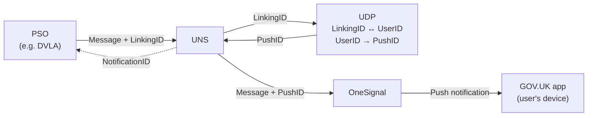
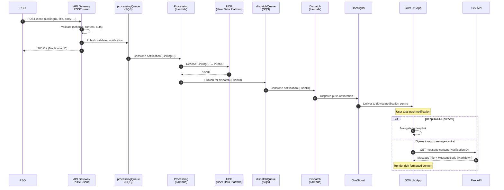
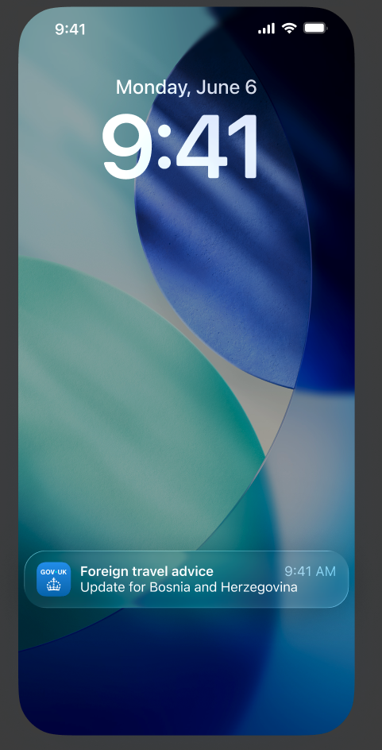
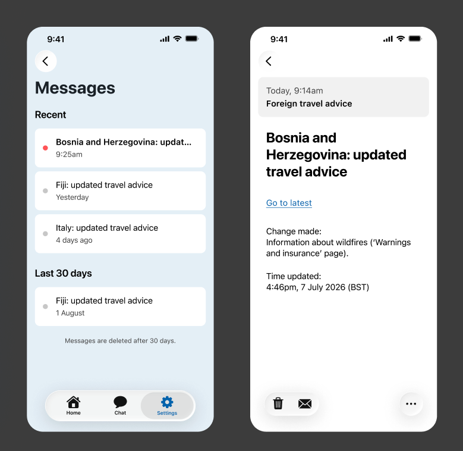
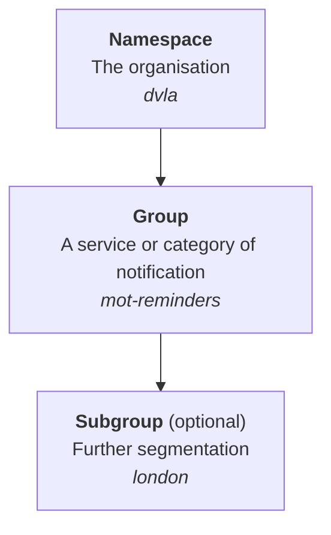
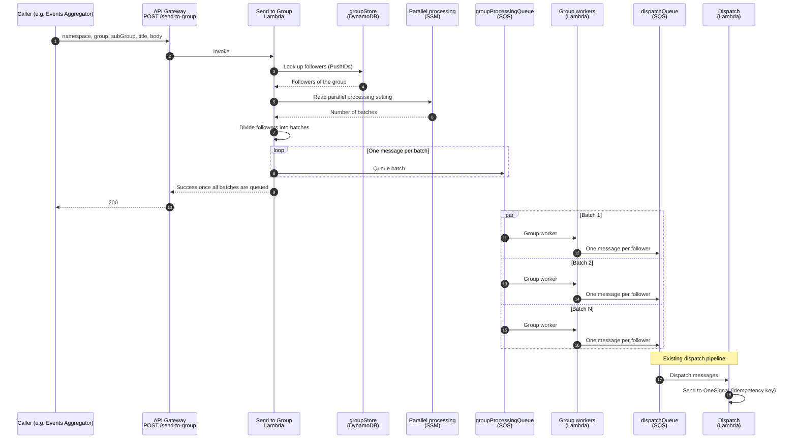

# GOV.UK Unified Notification Service — Service Overview

The Unified Notification Service (UNS) is GOV.UK's shared infrastructure for delivering notifications to users of the GOV.UK app. It provides a single, secure integration point for government departments and partner organisations, handling everything from message delivery and routing to user engagement tracking and analytics.

Without UNS, each organisation would need to build its own connection to push notification providers, manage user identifiers, and implement delivery tracking. UNS removes that burden entirely. A partner organisation sends a message with their own identifier for the recipient; UNS takes care of the rest.

Three parties interact with UNS:

- **Public Service Organisations (PSOs)** — government departments and services that send notifications to their users
- **GOV.UK app users** — citizens who receive notifications on their devices
- **GOV.UK app** — the mobile application that displays push notifications and hosts the in-app message centre

---

## Capabilities

| Capability | What it means |
| --- | --- |
| **Scale** | A queue-driven pipeline designed to handle millions of messages. Each stage — validation, processing, and dispatch — runs independently, so the system absorbs high-volume campaigns without degradation. |
| **Channels** | PSOs can deliver to a push notification on the device lock screen, an in-app message centre, or both — controlled per notification. |
| **Rich message content** | Message centre notifications support Markdown, enabling PSOs to deliver structured, long-form content alongside a short push alert in a single send. |
| **Groups** | Users opt in to named groups via the GOV.UK app. PSOs can broadcast to a whole group with a single request, rather than sending per-user. |
| **Analytics** | Every notification has a queryable status trail. Aggregate campaign statistics and a BigQuery export give PSOs visibility at any granularity. |
| **Reliability** | Circuit breaking, rate limiting, automatic retries, and 25 named operational alarms. |

---

## How the Identity Chain Works

UNS is built on a deliberate privacy principle: **no PSO ever holds a device push token**. When a PSO (DVLA for example) — or any other organisation — sends a notification, they only need to supply their own identifier for the recipient. UNS resolves the rest.

Here is how the chain is established:

1. A user signs up via OneLogin and receives a **UserID**.
2. When the user opens the GOV.UK app, the app registers with UNS. UNS derives a **PushID** (a one-way function of the UserID) and registers it with OneSignal, the push delivery platform. The PushID is also stored in the User Data Platform (UDP).
3. When the user links a government service account — for example, signing in via a DVLA WebView — the partner service returns a **LinkingID** (their own reference for the user). The app passes this to UNS, which creates a permanent mapping: LinkingID ↔ UserID in UDP.
4. When DVLA wants to send a notification, they send the message and the LinkingID. UNS looks up the PushID via UDP and dispatches the push notification to OneSignal, which delivers it natively to the user's device.
5. Each individual notification is assigned a **NotificationID** by UNS, which can be used by the PSO to track delivery and engagement.



*The PSO only ever holds its own LinkingID and the NotificationID that UNS returns. The UserID and PushID stay inside UNS and UDP. In the `/send` request the LinkingID goes in the `UserID` field.*

The same pattern applies to any PSO — DVLA is the initial example, but any organisation that establishes a linking step with their users can send notifications through this chain.

### Identifiers at a glance

| Identifier | Created by | Purpose |
| --- | --- | --- |
| **UserID** | OneLogin | Identifies the user across GOV.UK services |
| **PushID** | UNS / Flex | Derived from UserID; registered with OneSignal as the device target |
| **LinkingID** | Partner organisation | The PSO's own reference for the user; linked to UserID in UDP |
| **NotificationID** | UNS | Unique ID per notification; used for delivery tracking and analytics |

---

## Sending a Notification

### Authentication

PSOs connect to UNS over **mutual TLS (mTLS)** combined with an API key. There are no user-delegated tokens or OAuth flows — authentication is service-to-service. Each PSO is provisioned with client certificates that are rotated automatically.

---

### Sending to an individual user

PSOs send individual notifications via `POST /send`. A request can contain 1–10 notifications in a single call.

| Field | Required | Description |
| --- | --- | --- |
| `UserID` | Yes | The PSO's identifier for the recipient (resolved to a PushID by UNS via UDP) |
| `NotificationTitle` | Yes | Short title displayed on the push notification |
| `NotificationBody` | Yes | Body text displayed on the push notification |
| `MessageTitle` | No | Title displayed in the in-app message centre. Falls back to `NotificationTitle` if absent |
| `MessageBody` | No | Body displayed in the in-app message centre. Supports Markdown. Falls back to `NotificationBody` if absent |
| `Channel` | No | Which channel to use: `PUSH_NOTIFICATION_AND_MESSAGE_CENTRE` (default) or `MESSAGE_CENTRE_ONLY` |
| `DeeplinkURL` | No | Overrides the default tap action; routes the user to a specific screen in the GOV.UK app |
| `ExpiresInDays` | No | How many days the notification remains visible in the message centre. Overrides the platform default |
| `CampaignID` | No | Groups this notification with others for aggregate reporting |
| `DepartmentID` | No | Identifies the sending department for analytics |
| `NotificationID` | No | A UUID supplied by the PSO for idempotency. Generated by UNS if absent |

The response returns a `NotificationID` for each notification — the key used for all subsequent status and analytics queries.



**Important note**: As processing & dispatch are using adapter approach, our current integration points i.e. UDP & OneSignal, can we easily replaced, or parallelised to account for future edge cases (i.e. using a different identity resolution, or PN provider).

---

### Sending to a group

PSOs send group notifications via `POST /v1/send-to-group`. UNS fans out the message to every user who has joined the target group. All content and channel fields from the individual send apply here too.

The fields that differ are:

| Field | Required | Description |
| --- | --- | --- |
| `Namespace` | Yes | The top-level namespace for the group (e.g. `dvla`) |
| `Group` | Yes | The group name within the namespace (e.g. `mot-reminders`) |
| `Subgroup` | No | An optional further subdivision (e.g. `london`) |
| `GroupNotificationID` | No | A UUID for idempotency at the group level. Generated by UNS if absent |

---

## What the User Sees

### Push notification

When a notification is dispatched, the user receives a native push notification on their device — a title and short body visible on the lock screen and in the system notification tray.

Tapping the notification opens the full message in the in-app notification centre by default. If a `DeeplinkURL` was included, tapping instead navigates directly to the specified screen in the GOV.UK app.

[](./lock-screen.png)

---

### In-app message centre

The GOV.UK app hosts a notification centre where users can read their full message history. Each notification in the centre shows:

- The sender's display name
- Title and body (from `MessageTitle` / `MessageBody` if provided, otherwise from the push fields)
- The time it was dispatched

`MessageBody` supports **Markdown** — this is a core differentiator of the platform. A PSO can send a concise lock-screen alert alongside a fully formatted article in the message centre: headings, bullet lists, links, and emphasis, all in a single request.

Users can mark notifications as read, mark them as unread, or delete them. These actions are reported back to the PSO via the status trail.

[](./message-center-and-detail.png)

---

### The two-title pattern

Because push notifications and the message centre serve different reading contexts, UNS allows PSOs to supply different content for each channel in the same request.

| Field | Where it appears | Constraint |
| --- | --- | --- |
| `NotificationTitle` / `NotificationBody` | Push notification (lock screen) | Short — optimised for at-a-glance reading |
| `MessageTitle` / `MessageBody` | In-app message centre | Long-form; `MessageBody` supports Markdown |

If the message centre fields are omitted, the push fields are used in both places. PSOs can therefore start with the simplest approach (one set of fields) and layer in richer message centre content when needed.

---

## Groups

### What is a group?

A group is a named topic that users can subscribe to. Groups follow a three-level hierarchy:

```text
Namespace  →  Group  →  Subgroup (optional)
dvla           mot-reminders   london
```

The Namespace typically corresponds to the organisation; the Group to a specific service or category of notification; the Subgroup to any further segmentation the PSO needs.



*Full group address: `dvla / mot-reminders / london`. A send targets one address, and every user who has joined it receives the notification.*

---

### How users join and leave

Users manage their group memberships through the GOV.UK app. The app calls the Flex API on behalf of the user.

A single request can include multiple join and leave operations simultaneously. The result confirms the user's full list of current group memberships.

---

### How PSOs send to a group

A PSO sends one request targeting a Namespace and Group (and optionally a Subgroup). UNS resolves the membership list and dispatches a notification to every member, applying the same validation, processing, and dispatch pipeline as an individual send.

The PSO does not need to know who is in the group or how many members there are. They send once; UNS does the fan-out.



---

## Tracking and Analytics

### Notification status trail

Every notification moves through a defined lifecycle from the moment it is received by UNS to the moment it is acted on by the user. PSOs can query the full status history for any notification using its `NotificationID`.

**Pipeline states**

| Status | Meaning |
| --- | --- |
| `RECEIVED` | UNS has accepted the notification |
| `VALIDATED` | Content and routing checks passed |
| `PROCESSED` | Routing and pre-dispatch processing complete |
| `DISPATCHED` | Sent to the delivery provider (OneSignal) |
| `DELIVERED` | Confirmed delivered to the device |

**User interaction states**

| Status | Meaning |
| --- | --- |
| `NOTIFICATION_CENTRE_READ` | User opened the notification in the message centre |
| `NOTIFICATION_CENTRE_MARKED_AS_UNREAD` | User marked it as unread |
| `NOTIFICATION_CENTRE_HIDDEN` | User deleted the notification |

---

### Campaign reporting

When a `CampaignID` is included in a send, UNS groups all notifications under that campaign. PSOs can query aggregate counts at any time:

- **Processing summary** — how many notifications were received, processed, and dispatched
- **Usage summary** — how many were read, marked as unread, or hidden

This gives PSOs a single API call to assess the reach and engagement of a campaign without needing to query per-notification.

---

### BigQuery export

All notification events are streamed to BigQuery in real time. This enables:

- Organisation-level reporting and trend analysis
- Cross-campaign comparisons
- Custom dashboards and data exports

PSOs do not need to build or maintain any event infrastructure to access this data — it is produced as a by-product of normal notification processing.
