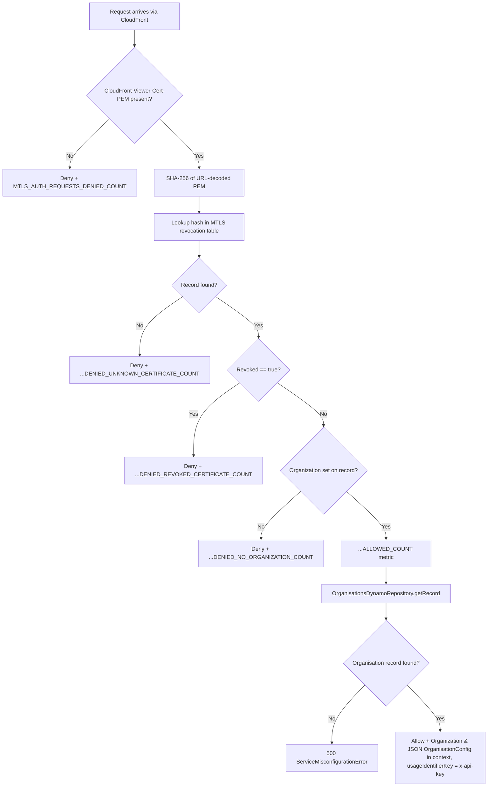

## MtlsCertificateRevocationAuthorizer

API Gateway **REQUEST** Lambda authorizer for the PSO API. It runs ahead of every PSO HTTP route. CloudFront terminates the mTLS handshake and has already verified the client certificate against the CA trust store and its expiry (see [Infrastructure Development Guide: mTLS](../../../../docs/infrastructure-development.md#mtls-certificate-infrastructure)). This authorizer confirms that the certificate CloudFront forwarded hasn't been revoked, works out which `Organization` the caller belongs to, and attaches that organisation's config for downstream handlers.

- **Type:** HTTP (API Gateway custom authorizer)
- **Operation ID:** `mtlsApiGatewayAuthorizer`
- **Identity sources:** `x-origin-header`, `x-api-key`, `CloudFront-Viewer-Cert-Subject`, `CloudFront-Viewer-Cert-Pem`, `CloudFront-Viewer-Cert-Validity`. If any is missing, API Gateway returns 401 without invoking the Lambda.
- **Certificate read from:** `headers['CloudFront-Viewer-Cert-PEM']` (URL-encoded PEM)

### Sample event

`APIGatewayRequestAuthorizerEvent`, relevant fields only (illustrative values):

```json
{
  "type": "REQUEST",
  "methodArn": "arn:aws:execute-api:eu-west-2:123456789012:abc123/dev/POST/send",
  "headers": {
    "x-api-key": "<usage plan key>",
    "x-origin-header": "<CloudFront origin secret>",
    "CloudFront-Viewer-Cert-PEM": "-----BEGIN%20CERTIFICATE-----%0A...%0A-----END%20CERTIFICATE-----",
    "CloudFront-Viewer-Cert-Subject": "CN=dvla.2026-09-27.2027-01-27,OU=dvla,O=DVLA",
    "CloudFront-Viewer-Cert-Validity": "NotBefore=...;NotAfter=..."
  }
}
```

### Infrastructure

- **DynamoDB**: `MTLSRevocationDynamoRepository` (the MTLS revocation table), read-only, keyed by the SHA-256 of the URL-decoded, trimmed certificate PEM. `OrganisationsDynamoRepository` (the Organisations table), read-only, to resolve `OrganisationConfig` for the certificate's organisation.
- **KMS**: decrypt permission on the shared sandbox KMS key (non-main environments only).
- No SQS, no outbound HTTP calls.
- API Gateway caches the result (`Allow`/`Deny` IAM policy) for `0` seconds (`resultsCacheTtl`), so this runs on every request; see [`UNSPSOResources.ts`](../../../../infrastructure/cdk/constructs/UNSPSOResources.ts).
- On `Allow` it returns the caller's `x-api-key` as `usageIdentifierKey`, which ties the request to that organisation's API Gateway usage plan (one per consumer, see [Consumers](../../../../docs/infrastructure-development.md#consumers-mtls-client-registry)).

### Logic



A `Deny` reaches the caller as **403**. Every deny branch logs at `error` with `certificateId` (or `methodArn` when no certificate was sent) and feeds the authentication alarms in [Alarms](../../../../docs/alarms.md#authentication-pso).

Downstream handlers read `Organization` and `OrganisationConfig` from `event.requestContext.authorizer` through `psoAuthorizerSchema`; see `PostMessage`, `PostGroupMessage` and [Configuration: Organisation config](../../../../docs/configuration.md#organisation-config).

> **Known gap:** the authorizer requires `x-origin-header` to be present but does not verify its value against the origin secret, so it relies on the edge (CloudFront + WAF) to guarantee a request came from CloudFront. That edge enforcement is not yet active; see [Infrastructure Development Guide: mTLS](../../../../docs/infrastructure-development.md#mtls-certificate-infrastructure). Tracked as a follow-up (`NOT-XXXX`).
