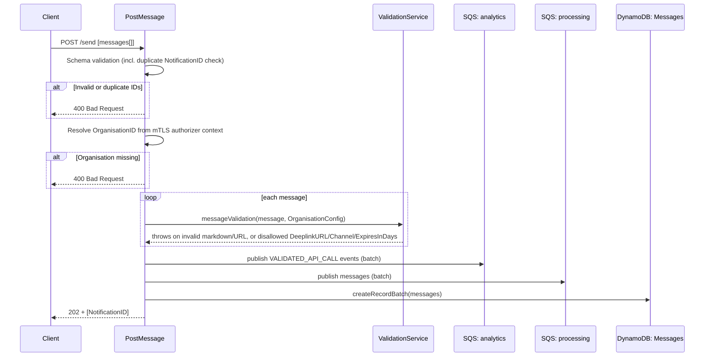

## PostMessage

Public ingestion endpoint for single-user notifications. Validates content, records the message, fires an analytics event, and hands it off to the `processing` queue for user-ID resolution and eventual dispatch.

- **Type:** HTTP (API Gateway)
- **Operation ID:** `postMessage`
- **Route:** `POST /send`

### Sample event

```json
{
  "body": "[{\"NotificationID\":\"200f6248-ed5b-4b73-be0b-4e9a2f8636e0\",\"DepartmentID\":\"DEP01\",\"UserID\":\"USER_ID\",\"CampaignID\":\"CAM_ID\",\"MessageTitle\":\"You have a new Message\",\"MessageBody\":\"Open Notification Centre to read your notifications\",\"NotificationTitle\":\"You have a new Notification\",\"NotificationBody\":\"Here is the Notification body.\"}]",
  "headers": { "Content-Type": "application/json" },
  "requestContext": {
    "requestId": "c6af9ac6-7b61-11e6-9a41-93e8deadbeef",
    "requestTimeEpoch": 1428582896000,
    "authorizer": {
      "Organization": "ORG01",
      "OrganisationConfig": "{\"MessageRetention\":{\"Allowed\":false},\"Channels\":[]}"
    }
  }
}
```

### Infrastructure

- **DynamoDB** - `NotificationsDynamoRepository` (the Messages table), read+write; writes a batch record per accepted message (`createRecordBatch`).
- **SQS** - publishes to the `processing` queue (batch) and, via `AnalyticsService`, to the `analytics` queue (`VALIDATED_API_CALL` event per message).
- The request schema rejects the whole request with `400` if two items share a `NotificationID` (`Duplicate NotificationIDs are not allowed`, path `[index, 'NotificationID']`).
- Content is validated in-process by `ValidationService.messageValidation`: SSM-configured protocol/hostname allow-lists for the body, plus `DeeplinkURL`/`Channel`/`ExpiresInDays` checked against the feature flags and the organisation's config (see [Configuration](../../../../docs/configuration.md#feature-flags)). A failure rejects the whole request with `400` before anything is written.
- `ExpiresInDays` is stored as `RequestedDaysToExpire`, which sets the record's TTL (see [Configuration: Message expiry](../../../../docs/configuration.md#message-expiry-ttl)).
- `postMessage` writes directly to the Messages table and publishes straight to `processing`. It does not use the `incoming` queue or [`sqs.validation`](../sqs.validation/README.md), which currently has no producer in this repository.

### Logic


