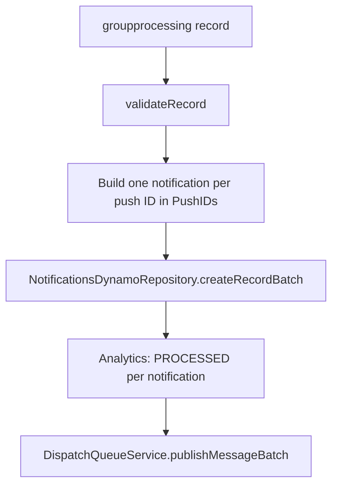

## GroupProcessingWorker

Feature-flagged (`config.featureFlag.groups`, an infrastructure-level deployment gate, off in `prod`) SQS worker that fans a group message out into individual per-user notifications. Each invocation takes one chunk of push IDs that [`postGroupMessage`](../http.postGroupMessage/README.md) cached and builds a notification for each one. It sends them on to dispatch and re-queues itself until the chunk is empty.

- **Type:** SQS (`BatchQueueOperation`)
- **Operation ID:** `groupProcessingWorker`
- **Trigger:** the `groupprocessing` queue
- **Kill switch:** `SSMParameters.Config.GroupProcessingWorker.Enabled` (see [Configuration](../../../../docs/configuration.md))

### Sample event

Record body (relevant fields only):

```json
{
  "GroupMessage": {
    "Namespace": "travel",
    "Group": "france",
    "Subgroup": "immediate",
    "GroupNotificationID": "1234",
    "OrganisationID": "ORG_01",
    "NotificationTitle": "Travel Alert Update",
    "NotificationBody": "You have a new message in the message center.",
    "MessageTitle": "MOCK_LONG_TITLE",
    "MessageBody": "MOCK_LONG_MESSAGE"
  },
  "GroupNotificationID": "1234",
  "PushIDs": ["pushID1", "pushID2"],
  "APIGWExtendedID": "requestId",
  "ReceivedDateTime": "2026-08-01T12:00:00.000Z",
  "ValidatedDateTime": "2026-08-01T12:00:00.600Z"
}
```

### Infrastructure

- **ElastiCache (Redis)**: not used for push IDs (they travel in the message). Used indirectly by `AnalyticsService`.
- **DynamoDB**: `NotificationsDynamoRepository` (the Messages table), read/write. One record per built notification, with `RequestedDaysToExpire` carried over from `ExpiresInDays`.
- **SQS**: publishes built notifications to the `dispatch` queue, and analytics events (`PROCESSED`) to the `analytics` queue.
- **VPC**: VPC-attached, because `AnalyticsService` talks to ElastiCache.
- Notification IDs are deterministic. `generateNotificationIDForGroupMessage(pushID, groupMessage)` (in [`checksumString.ts`](../../../common/utils/checksumString.ts)) hashes the push ID together with the group message, so a retried record produces the same IDs.

### Observability

| Metric                                                       | When                                                                                                   |
| ------------------------------------------------------------ | ------------------------------------------------------------------------------------------------------ |
| `GROUP_PROCESSING_WORKER_STARTED` / `_COMPLETED` / `_FAILED` | Per-record lifecycle hooks                                                                             |
| `GROUP_PROCESSING_DURATION_PER_MESSAGE`                      | p95 is alarmed as `GroupProcessingDurationP95PerMessageHigh`, see [Alarms](../../../../docs/alarms.md) |
| `BATCH_ITEM_FAILURES_GROUP_PROCESSING`                       | Alarmed as `GroupProcessingBatchItemFailures`                                                          |

The groups dashboard ([`UNSPSOGroupsFlow.ts`](../../../../infrastructure/cdk/constructs/dashboards/UNSPSOGroupsFlow.ts)) charts these metrics.

### Logic



> Each record carries its whole chunk of push IDs, so an SQS retry reprocesses the entire chunk. This is safe because notification IDs are deterministic (see above), so retries overwrite rather than duplicate records.
