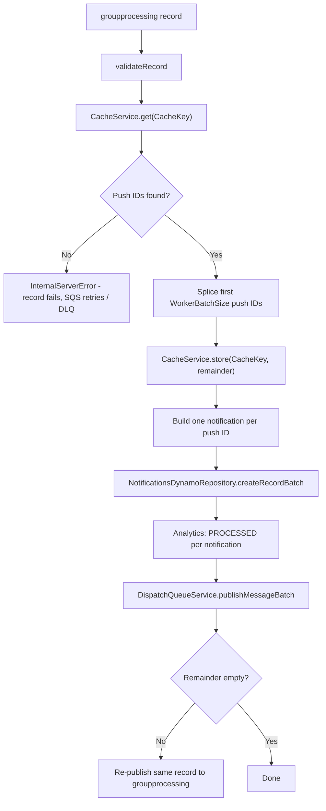

## GroupProcessingWorker

Feature-flagged (`config.featureFlag.groups`, an infrastructure-level deployment gate, off in `prod`) SQS worker that fans a group message out into individual per-user notifications. Each invocation takes one chunk of push IDs that [`postGroupMessage`](../http.postGroupMessage/README.md) cached and builds a notification for each one. It sends them on to dispatch and re-queues itself until the chunk is empty.

- **Type:** SQS (`BatchQueueOperation`)
- **Operation ID:** `groupProcessingWorker`
- **Trigger:** the `groupprocessing` queue
- **Kill switch:** `SSMParameters.Config.GroupProcessingWorker.Enabled` (see [Configuration](../../../../docs/configuration.md))

### Sample event

Record body (relevant fields only):

```json
{
  "GroupMessage": {
    "Namespace": "travel",
    "Group": "france",
    "Subgroup": "immediate",
    "GroupNotificationID": "1234",
    "OrganisationID": "ORG_01",
    "NotificationTitle": "Travel Alert Update",
    "NotificationBody": "You have a new message in the message center.",
    "MessageTitle": "MOCK_LONG_TITLE",
    "MessageBody": "MOCK_LONG_MESSAGE"
  },
  "GroupNotificationID": "1234",
  "WorkerID": 0,
  "CacheKey": "Worker/GroupProcessingWorker/1234/0",
  "APIGWExtendedID": "requestId",
  "ReceivedDateTime": "2026-08-01T12:00:00.000Z",
  "ValidatedDateTime": "2026-08-01T12:00:00.600Z"
}
```

### Infrastructure

- **ElastiCache (Redis)**: `CacheService` reads the remaining push IDs from `CacheKey`, then writes the unprocessed remainder back to the same key.
- **SSM**: reads `SSMParameters.Group.Dispatch.WorkerBatchSize` (default `100`), the number of push IDs handled per invocation.
- **DynamoDB**: `NotificationsDynamoRepository` (the Messages table), read/write. One record per built notification, with `RequestedDaysToExpire` carried over from `ExpiresInDays`.
- **SQS**: publishes built notifications to the `dispatch` queue, analytics events (`PROCESSED`) to the `analytics` queue, and the original record back onto `groupprocessing` if push IDs remain.
- **VPC**: VPC-attached, because it talks to ElastiCache.
- Notification IDs are deterministic. `generateNotificationIDForGroupMessage(pushID, groupMessage)` (in [`checksumString.ts`](../../../common/utils/checksumString.ts)) hashes the push ID together with the group message, so a retried record produces the same IDs.

### Observability

| Metric                                                       | When                                                                                                   |
| ------------------------------------------------------------ | ------------------------------------------------------------------------------------------------------ |
| `GROUP_PROCESSING_WORKER_STARTED` / `_COMPLETED` / `_FAILED` | Per-record lifecycle hooks                                                                             |
| `GROUP_PROCESSING_DURATION_PER_MESSAGE`                      | p95 is alarmed as `GroupProcessingDurationP95PerMessageHigh`, see [Alarms](../../../../docs/alarms.md) |
| `BATCH_ITEM_FAILURES_GROUP_PROCESSING`                       | Alarmed as `GroupProcessingBatchItemFailures`                                                          |

The groups dashboard ([`UNSPSOGroupsFlow.ts`](../../../../infrastructure/cdk/constructs/dashboards/UNSPSOGroupsFlow.ts)) charts these metrics.

### Logic



> The remainder is written back to the cache **before** the batch is dispatched. If a record fails after that point, an SQS retry resumes from the remainder and the already-spliced push IDs are not reprocessed. Bear this in mind when investigating missing group notifications.
